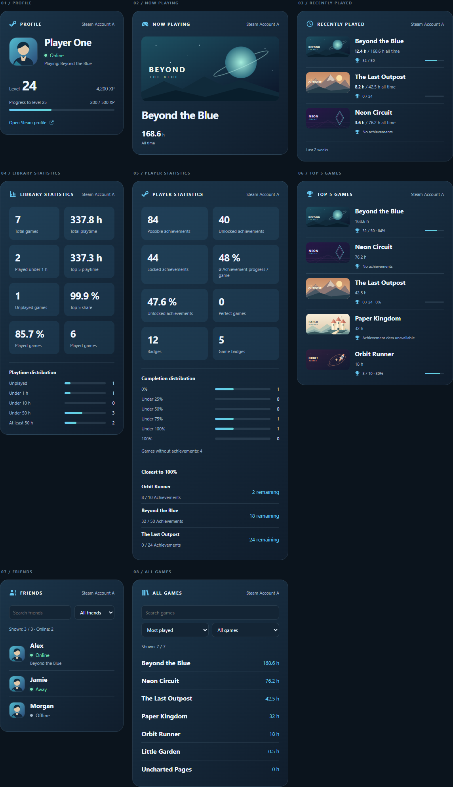
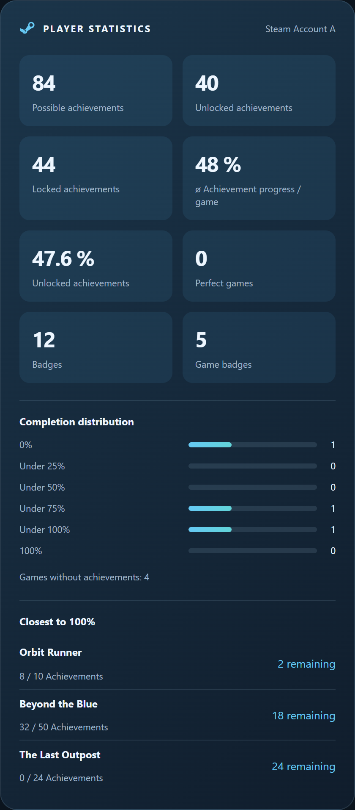
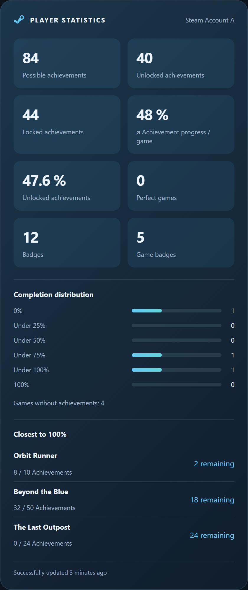

# Steam Tracker Card

A Home Assistant dashboard card for [Steam Tracker](https://github.com/lefidelity/steam-tracker).
Select an account and a view in the visual editor, then add more cards to build your dashboard.

**Source version: 1.0.0** · [Deutsche Anleitung](docs/README_de.md) · [Visual guide](docs/visual-guide.md)



## Requirements

- Home Assistant **2025.10.0 or newer**.
- The Steam Tracker integration. Use integration **1.0.0** for all documented attributes;
  support for older sensors is listed under [Compatibility](#compatibility).
- Steam data accessible to the integration. The card reads Home Assistant sensors
  and does not call the Steam API or need an API key.

The integration and card are separate installations. The integration also works
without this card. Its [English sensor reference](https://github.com/lefidelity/steam-tracker/blob/main/docs/sensors_en.md)
and [German sensor reference](https://github.com/lefidelity/steam-tracker/blob/main/docs/sensors_de.md)
describe the sensor states, attributes, and update intervals.

## Installation

### HACS

1. In HACS, add `https://github.com/lefidelity/steam-tracker-card` as a custom
   repository of type **Dashboard** if the card is not listed.
2. Download Steam Tracker Card.
3. Under **Settings > Dashboards > Resources**, check that
   `/hacsfiles/steam-tracker-card/steam-tracker-card.js` is registered as a
   **JavaScript module**. Add it if necessary; the resource menu may require
   advanced mode in your Home Assistant user profile.
4. Reload the browser and add **Steam Tracker Card** to a dashboard.

[](https://my.home-assistant.io/redirect/hacs_repository/?owner=lefidelity&repository=steam-tracker-card&category=plugin)

### Manual installation

1. Copy `dist/steam-tracker-card.js` from the source tree, or the JavaScript file
   from a release, to `<HA configuration>/www/steam-tracker-card.js`.
2. If you created `www` for the first time, restart Home Assistant.
3. Under **Settings > Dashboards > Resources**, register
   `/local/steam-tracker-card.js?v=1.0.0` as a **JavaScript module**.
4. Reload the browser and add the card.

Register the resource once, using either the HACS or manual path. For manual
updates, replace the file and change the version parameter to clear the browser cache.

## Views and layouts

| `view` | Content |
| --- | --- |
| `profile` | Avatar, name, presence, Steam level, and XP progress |
| `current_game` | Current game artwork, title, and lifetime playtime |
| `recent_games` | Up to five recent games, two-week playtime, and optional achievements |
| `library_stats` | Game counts, hours, played percentage, top-five share, and playtime distribution |
| `player_stats` | Achievement counts and percentages, completion groups, candidates, and badges |
| `top_games` | Up to five most-played games, lifetime hours, and optional achievements |
| `friends` | Friends with presence and current game; search and online filter |
| `games` | Full library; search, sorting, and exact-minute playtime filters |

Choose **Detailed**, **Compact**, or **Single line**. Detailed shows the most
information; Compact uses smaller images and less spacing. Single line shows
one row per list item or a summary row for profiles, current games, and statistics.
The library summary shows total games, total hours, and games under one hour;
the player summary shows unlocked achievements, perfect games, and average progress.

Friends and the full library scroll when long. The recent-games limit does not
shorten these lists. Appearance can follow your Home Assistant theme or use
**Steam blue**. No additional custom cards are required.

The [visual guide](docs/visual-guide.md) compares all 96 combinations of view,
layout, language, and appearance. All examples use fictional accounts and artwork.

## Account selection and configuration

Select **Steam account** and **View** in the visual editor. A single discovered
account is selected automatically. With multiple accounts, select one explicitly.
Discovery uses the entity registry, so renamed entity IDs continue to work.
If account names are identical, rename their account devices in Home Assistant.

**Show username** controls the account label in the heading; the profile's player
name remains visible. **Show title** controls the view title and icon. A custom
title stays saved when hidden. Single-line layouts hide the heading regardless
of these settings.

For manual assignments, select sensors from the same account under
**Manual sensor assignment**. This also works with legacy YAML sensors or when
your Home Assistant user cannot read the entity/device registries.

```yaml
type: custom:steam-tracker-card
view: profile
appearance: steam
layout: detailed
```

With several accounts, select the account in the editor so it writes the correct
`account` value. It is an internal account identifier, not an account name.

```yaml
type: custom:steam-tracker-card
view: recent_games
limit: 3
sort: playtime
show_achievements: true
entities:
  recent_games: sensor.steam_tracker_recent
  recent_achievements: sensor.steam_tracker_recent_achievements
```

Use your actual entity IDs for manual assignments.

| Option | Default | Values / meaning |
| --- | --- | --- |
| `view` | `profile` | One of the eight views above |
| `account` | Automatic for one account | Identifier saved by the visual editor |
| `title` | View title | Custom text |
| `show_title` | `true` | Show the heading and icon |
| `show_username` | `true` | Show the account label in the heading |
| `show_data_status` | `false` | Show the last successful fetch time |
| `layout` | `detailed` | `detailed`, `compact`, `single_line` |
| `appearance` | `theme` | `theme`, `steam` |
| `language` | `auto` | `auto`, `de`, `en`; other Home Assistant languages use English |
| `show_images` | `true` | Show images where the view supports them |
| `show_achievements` | `true` | Show recent/top-game achievements; hidden in single-line layouts |
| `limit` | `3` | Integer 1–5; recent games only |
| `sort` | `recent` | Recent-game order: `recent` (Steam order), `playtime` (two weeks), `total` (lifetime) |
| `library_sort` | `hours` | Full-library default: `hours` (most played), `name` (A–Z) |
| `library_filter` | `all` | Full-library default: `all`, `played`, `unplayed`, `under_1_hour`, `1_to_10_hours`, `10_to_50_hours`, `50_hours_or_more` |
| `item_action` | `none` | `none`, `steam`, `more-info`; action when selecting a game/friend name |
| `entities` | Automatic | Sensor overrides: `status`, `profile`, `game`, `recent_games`, `recent_achievements`, `playtime`, `global_stats`, `friends` |

### Profile and recent games

An offline profile shows **Last online …** when the status sensor provides a
valid `lastlogoff`. For a connected player with a current game, it shows
**Playing: <game name>** instead. Presence `Snooze` is displayed as **Idle**;
`Away` remains **Away**. The underlying sensor values do not change.

Recent games use the integration's list of at most five games. Sorting applies
to that list; **Steam order** keeps the response order. Detailed rows show
`1.5 h / 240 h all time`, with **Last 2 weeks** in the footer. Compact and
single-line rows show only the two-week playtime. Achievement progress is the
game's overall progress, not a count of achievements earned in those two weeks.

### Library statistics

The two **Played games** tiles show the played percentage and the played-game
count. A game counts as played after one recorded minute, even when rounded
hours show `0.0`. The **Played under 1 h** tile includes unplayed games;
the separate **Under 1 h** distribution bar counts only games with 1–59 minutes.

| Distribution label | Lifetime minutes |
| --- | --- |
| Unplayed | 0 |
| Under 1 h | 1–59 |
| Under 10 h | 60–599 |
| Under 50 h | 600–2999 |
| At least 50 h | 3000 or more |

The bars show each group's share of the library and its game count. **Top 5 share**
is the five most-played games' share of all recorded minutes. Empty libraries
show zero counts and percentages. Tooltips give the exact time ranges.

### Player statistics

Detailed and compact layouts use these tile pairs:

| Left | Right |
| --- | --- |
| Possible achievements | Unlocked achievements (count) |
| Locked achievements | ø Achievement progress / game |
| Unlocked achievements (percentage) | Perfect games |
| Badges | Game badges |

**ø Achievement progress / game** averages the completion percentages of games
with achievements. Every game has equal weight, including games with no unlocked
achievements. **Unlocked achievements** as a percentage divides all unlocked
achievements by all possible achievements. For games at 1/1 and 0/99, the average
is 50% and the overall percentage is 1%.

Games without achievements are excluded from both percentages and perfect games.
With no possible achievements, the overall percentage is shown as `—`; the
integration's average is 0. **Game badges** counts game/trading-card badges,
not individual trading cards.

The completion bars use six separate groups: 0%, >0–<25%, 25–<50%, 50–<75%,
75–<100%, and 100%. Their short labels are **0%**, **Under 25%**, **Under 50%**,
**Under 75%**, **Under 100%**, and **100%**. Tooltips show the exact boundaries.
Games without achievements are counted below the bars.

**Closest to 100%** lists up to five incomplete games with the fewest remaining
achievements. Ties use the higher exact completion percentage, then name and app ID.
Games with no unlocked achievements can qualify; completed games and games without
achievements cannot. This ranking does not estimate difficulty or time to finish.



### Data freshness

Enable **Show data freshness**, or set `show_data_status: true`, to display a footer
such as **Successfully updated 3 minutes ago**. Its tooltip gives the exact time.
The text refreshes locally each minute without Steam requests.

The footer uses `last_successful_update`. When several sensors contribute to a
view, it uses the oldest timestamp of the displayed sources. Profiles include
status and level, plus the current game when shown; recent games include achievement
data when shown. A missing, unknown, or unavailable source, or a missing/invalid/future timestamp,
hides the footer. Home Assistant's `last_changed` and `last_updated` are not used.
A status/game cache hit preserves the integration's original fetch time.



### Library filters and name actions

In **All games**, search, sorting, and playtime filters work together. Set the
saved defaults with **Default library sort** and **Default library filter**.
Changes made directly on the card last until reload. Changing the account or
manual sensor assignments resets those temporary choices.

Filters use the minute ranges above. **Played** means at least one minute.
Missing or invalid exact-minute data disables the playtime filter and shows all
games; search and sorting remain available.

For current, recent, top-five, and full-library games, and for friends,
**Name click action** offers **No action**, **Open Steam**, or **Sensor details**.
Steam links open a new tab: games use the store page, friends use a valid Steam
profile URL or SteamID64. Sensor details opens the corresponding account sensor.
The same `item_action` setting applies to completion-candidate names in YAML.
Actions support keyboard navigation and default to **No action**.

```yaml
type: custom:steam-tracker-card
view: games
library_sort: name
library_filter: unplayed
item_action: steam
```

## Missing data and privacy

Missing sensors, `unknown`, and `unavailable` have different messages. An empty
library or friends list is a valid result. Zero values remain visible; unknown
achievement progress is not replaced with zero. Profile status and level can be
displayed independently when one source is unavailable.

The friends **Online only** filter includes connected states such as Busy, Away,
and Idle. Offline and unknown presence are excluded.

Game images and avatars load in the browser from URLs supplied by the sensors,
normally Steam's image CDN. Images use no-referrer. The card does not store or
send Steam API keys; it uses your existing Home Assistant session.

## Compatibility

| Feature | Minimum integration version |
| --- | --- |
| Account devices for automatic selection | 0.6.0 |
| Library usage counts and distribution | 0.7.1 |
| Exact-minute library filters, full-library Steam links, data freshness | 0.9.5 |
| Remaining achievements, overall percentage, completion groups and candidates | 0.9.8 |

Older registered sensors can also be grouped by configuration entry or their
unique IDs. Legacy YAML sensors can be assigned manually. Missing new attributes
hide their additional tiles/bars; older data is not filled with guessed values.
The integration and card have independent versions and are updated separately.

## Local preview and checks

`dist/steam-tracker-card.js` is the source and the distributable module. No build
step or runtime dependencies are required.

From the repository root:

```console
python -m http.server 8129 --bind 127.0.0.1
```

Open `http://127.0.0.1:8129/preview/index.html`. The preview uses fictional accounts,
five game illustrations, and local SVG files. It makes no Steam requests.

With Node.js 20 or newer:

```console
node --check dist/steam-tracker-card.js
node --test tests/card.test.mjs
```

The browser checks need a development installation of Playwright:

```console
node tests/browser.mjs
```

Optional arguments are `--playwright <path-to-playwright/index.mjs>`,
`--browser <browser-executable>`, and `--screenshot <output.png>`. Use a temporary
directory for test captures. The script starts and stops its local HTTP server.

Automated checks use mocked Home Assistant data. For a live installation, check
editor saving/reloading, account selection, renamed entities, restricted users,
integration reload, mobile layouts, and Sections/Masonry dashboards. HACS
installation is a separate check from the browser preview.

## License

[MIT License](LICENSE). The complete license and copyright notice are also in
`dist/steam-tracker-card.js` so they accompany the standalone file.

Not affiliated with Valve, Steam, Home Assistant, or HACS.
