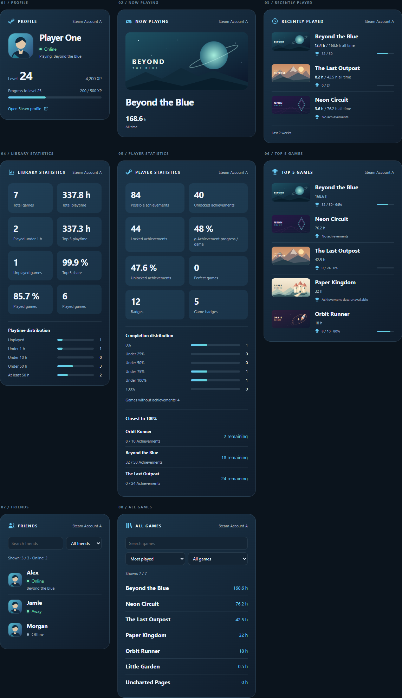
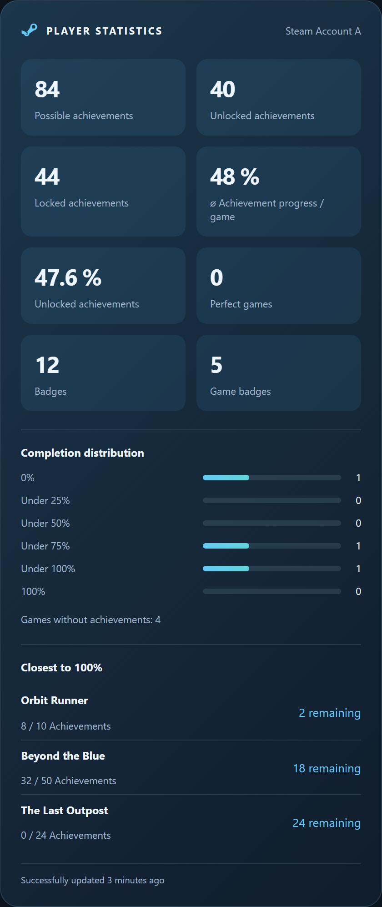
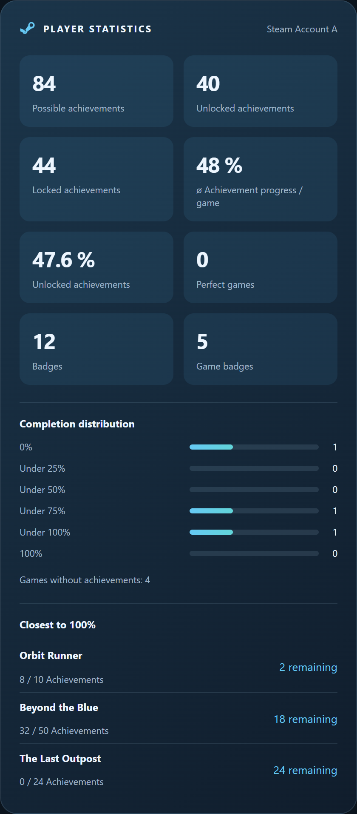

# Steam Tracker Card

Eine konfigurierbare Lovelace-Karte für **Steam Tracker**: Karte hinzufügen,
Steam-Konto und Ansicht auswählen, mehrere Karten zum eigenen Dashboard kombinieren.
Mit visuellem Editor, Deutsch/Englisch und Unterstützung für helle und dunkle Themes.

[English documentation and full configuration reference](../README.md)

Zustände, Attributtypen und Leer-/Fehlerwerte beschreibt die Integration in der
[deutschen Sensorreferenz](https://github.com/lefidelity/steam-tracker/blob/main/docs/sensors_de.md)
und der [englischen Referenz](https://github.com/lefidelity/steam-tracker/blob/main/docs/sensors_en.md).
Die Integration kann auch unabhängig von dieser Karte verwendet werden.



[Bild-Dokumentation: alle Ansichten, Darstellungen, Sprachen und Layouts](visual-guide.md).
Direkt zu [Steam-Blau / Deutsch](visual-guide/steam-de.md),
[Home-Assistant-Theme / Deutsch](visual-guide/theme-de.md),
[Steam-Blau / Englisch](visual-guide/steam-en.md) oder
[Home-Assistant-Theme / Englisch](visual-guide/theme-en.md).
Die Galerie zeigt 96 Einzelbilder: Voll (`detailed`), Kompakt (`compact`) und
Einzeilig (`single_line`) für jede Ansicht nebeneinander. Ein Klick auf das Bild
öffnet die volle Auflösung. Das Home-Assistant-Theme nutzt eine helle Referenz;
die Farben im eigenen Dashboard hängen vom gewählten Theme ab.

## Ansichten

| Ansicht | Inhalt |
| --- | --- |
| Profil (`profile`) | Avatar, Spielername, Status, Level und XP-Fortschritt |
| Aktuelles Spiel (`current_game`) | Spielbild, Titel und Gesamtspielzeit |
| Kürzlich gespielt (`recent_games`) | Spiele der letzten zwei Wochen, Spielzeiten und optional Erfolge |
| Bibliothek-Statistik (`library_stats`) | Spieleanzahl, Spielzeit, Spielquote, ungespielte Spiele, Top-5-Anteil und Spielzeit-Verteilung |
| Spieler-Statistik (`player_stats`) | Erfolge, perfekte Spiele, durchschnittlicher Abschluss und Abzeichen |
| Top-5-Spiele (`top_games`) | Die fünf meistgespielten Spiele mit Spielzeit und optional Erfolgen |
| Freunde (`friends`) | Freunde mit Status und aktuellem Spiel; Suche und Online-Filter |
| Spiele-Gesamtübersicht (`games`) | Vollständige Bibliothek mit Spielzeiten, Suche und Sortierung |

Mit den erweiterten Sensordaten zeigt die Bibliothek-Statistik zusätzlich die
Spielquote, gespielte und ungespielte Spiele und den Top-5-Anteil an der Gesamtzeit.
Ausführlich und Kompakt enthalten fünf Balken: ungespielt, gespielt unter einer
Stunde, 1–<10 Stunden, 10–<50 Stunden und mindestens 50 Stunden. Jeder Balken zeigt
den Anteil an der gesamten Bibliothek und daneben die Spieleanzahl. Ob ein Spiel
ungespielt ist, bestimmen die exakten Steam-Minuten. Leere Bibliotheken zeigen
Nullwerte; bei älteren Sensoren erscheinen die Ergänzungen nach dem Update der
Integration. Der Einzeiler behält seine drei bisherigen Hauptkennzahlen.
Die kürzeren Verteilungsbeschriftungen lauten **unter 10 h**, **unter 50 h** und
**ab 50 h**. Die Zeitgruppen bleiben 1–<10, 10–<50 und ≥50 Stunden.
Tooltips und zugängliche Beschriftungen erklären **1 bis unter 10 Stunden**,
**10 bis unter 50 Stunden** und **50 Stunden oder mehr**. Genau 50 Stunden
gehören bereits zur letzten Gruppe.
Die Kachel **Ungespielte Spiele** steht neben dem **Top-5-Anteil**. Darunter
zeigen die beiden Kacheln **Gespielte Spiele** den Prozentwert und die Anzahl.
Die weiteren Beschriftungen lauten **Spiele insgesamt** und **Unter 1 h gespielt**;
die kürzeste gespielte Zeitgruppe heißt **unter 1 h**.

Die Überschriften nutzen Controller für das aktuelle Spiel, Uhr für kürzlich
gespielte Spiele, Diagramm für Bibliothek-Statistik, Pokal für Top-5-Spiele,
Personen für Freunde und Bücher für die Spiele-Gesamtübersicht. Unter dem
aktuellen Spielbild folgen direkt Spielname und Spielzeit. Kürzlich gespielte
und Top-5-Spiele haben Trennlinien zwischen den Einträgen; Bilder und Spieltitel
sind oben bündig ausgerichtet.

Ausführlich, Kompakt oder Einzeiler; Home-Assistant-Theme oder Steam-Blau.
Zusätzliche Karten wie button-card, bar-card oder card-mod werden nicht benötigt.

**Kompakt** zeigt kleine Bilder, engere Abstände und Profil beziehungsweise
aktuelles Spiel nebeneinander statt untereinander. **Einzeiler** reduziert Profil,
aktuelles Spiel und Statistiken auf eine Zeile; Listen zeigen eine Zeile pro
Eintrag. Bei Statistiken bleiben die drei wichtigsten Kennzahlen sichtbar,
XP-Details und Erfolgsaufschlüsselungen entfallen. Freunde und Spiele behalten
ihre Suchfelder und werden bei langen Listen scrollbar. Die Begrenzung für
kürzlich gespielte Spiele kürzt diese vollständigen Listen nicht. Suche und
Listenfilter gelten lokal für die Karte. Nach dem Neuladen gelten wieder die
im Editor gespeicherten Bibliotheksvorgaben.

## Voraussetzungen

- Home Assistant ab 2025.10. Browserprüfungen nutzen eine Simulation;
  die Installation in einer echten Home-Assistant-Oberfläche muss noch geprüft werden.
- Die [Steam-Tracker-Integration](https://github.com/lefidelity/steam-tracker).
  Die automatische Kontozuordnung nutzt Sensor-Unique-IDs und Kontogeräte
  (Integration 0.6.0 oder neuer). Ältere registrierte Sensoren können
  über den Konfigurationseintrag gruppiert werden; YAML-Sensoren lassen sich
  manuell zuweisen.
- Die Integration muss auf die Steam-Daten zugreifen können. Die Karte behebt
  keine Zugangsdaten- oder Privatsphäre-Probleme.

## Installation

Das Repository ist [lefidelity/steam-tracker-card](https://github.com/lefidelity/steam-tracker-card).
Ein Eintrag in der HACS-Standardliste besteht noch nicht. HACS-Validierung und
Tests in einer echten Home-Assistant-Instanz stehen noch aus.

### HACS

1. `https://github.com/lefidelity/steam-tracker-card` als
   benutzerdefiniertes Repository vom Typ **Dashboard** hinzufügen.
2. Karte herunterladen.
3. Unter **Einstellungen → Dashboards → Ressourcen** prüfen, ob
   `/hacsfiles/steam-tracker-card/steam-tracker-card.js` als **JavaScript-Modul**
   eingetragen wurde. Falls nötig, selbst hinzufügen. Eventuell muss der
   erweiterte Modus aktiviert sein.
4. Browser neu laden und **Steam Tracker Card** zum Dashboard hinzufügen.

[](https://my.home-assistant.io/redirect/hacs_repository/?owner=lefidelity&repository=steam-tracker-card&category=plugin)

### Manuell

1. `dist/steam-tracker-card.js` nach
   `<HA-Konfigurationsordner>/www/steam-tracker-card.js` kopieren.
2. Wenn `www` neu angelegt wurde, Home Assistant neu starten.
3. Unter **Einstellungen → Dashboards → Ressourcen**
   `/local/steam-tracker-card.js?v=0.9.9` als **JavaScript-Modul** hinzufügen.
4. Browser neu laden und die Karte über die Kartenauswahl hinzufügen.

Nur eine Ressource registrieren. Bei manuellen Updates den Versionsparameter
der URL ändern und den Browser neu laden.

## Bedienung

Im visuellen Editor **Konto** und **Ansicht** wählen. Ein einziges erkanntes Konto
wird automatisch verwendet. Bei mehreren Konten ist eine explizite Auswahl nötig.
Umbenannte Entity-IDs werden über die Registrierung erkannt. Bei gleichen
Kontonamen hilft ein eindeutiger Name für das jeweilige Kontogerät.

Titel, Darstellung, Aussehen, Sprache und Bilder sind einstellbar. Für kürzlich
gespielte Spiele gibt es zusätzlich Anzahl (1–5), Sortierung und Erfolge.
**Benutzernamen anzeigen** steuert den Kontonamen rechts oben; der Spielername
im Profil bleibt sichtbar. **Titel anzeigen** blendet Überschrift und Symbol
unabhängig davon ein oder aus. Ein eigener Titel bleibt beim Ausblenden gespeichert.
Beide Optionen sind standardmäßig aktiv (`show_username: true`, `show_title: true`).
Im Einzeiler bleibt die Kopfzeile wie bisher verborgen.
Auch bei den Top-5-Spielen lassen sich Erfolge ein- und ausblenden; diese Ansicht
zeigt immer bis zu fünf Spiele. Alle acht Sensorrollen können manuell zugewiesen werden.
Die Integration liefert derzeit höchstens fünf kürzlich gespielte Spiele;
Sortierung und Begrenzung wirken nur auf diese Liste. „Steam-Reihenfolge“ behält
die Reihenfolge der API bei.

Bei Offline-Profilen steht in Ausführlich und Kompakt **Zuletzt online vor …**
direkt unter dem Status. Dafür nutzt die Karte `lastlogoff` aus dem Statussensor
und aktualisiert die relative Zeit jede Minute ohne Steam-Abfragen. Fehlende,
ungültige oder zukünftige Zeitstempel werden ausgeblendet; bei Online-Profilen
erscheint keine frühere Abmeldezeit. Läuft bei einem online verbundenen Spieler
ein Spiel, steht an derselben Stelle **Spielt: <Spielname>** aus dem Spielsensor
dieses Kontos. Das gilt auch für Status wie Abwesend oder Beschäftigt. Ohne
laufendes Spiel oder bei fehlenden, unbekannten beziehungsweise nicht verfügbaren
Spieldaten entfällt die Zeile. Dafür sind keine zusätzlichen Steam-Abfragen nötig.
Der XP-Text lautet **Fortschritt zu Level …**.

Freunde und Profile zeigen Steams Status `Snooze` als **Inaktiv** an. `Away`
bleibt **Abwesend**; die zugrunde liegenden Sensorwerte der Integration bleiben
unverändert.

### Datenstand

Die Checkbox **Datenstand anzeigen** (`show_data_status: true`) ergänzt in jeder
Ansicht und Darstellung eine Zeile wie **Erfolgreich aktualisiert vor 3 Minuten**.
Sie ist standardmäßig aus. Der Tooltip zeigt Datum und Uhrzeit; die relative Zeit
aktualisiert sich lokal jede Minute ohne Steam-Abfragen. Beim Entfernen der Karte
stoppt der Timer.

Dafür muss auch die Integration aktualisiert werden: Ihr neues Attribut
`last_successful_update` enthält den Zeitpunkt eines erfolgreichen, geprüften
Abrufs, auch bei unveränderten Werten und bestätigt leeren Ergebnissen.
Das Attribut ist ab Integration 0.9.5 verfügbar.
`last_changed` und `last_updated` werden nicht als Ersatz verwendet.
Der 15-Sekunden-Cache der Integration für Status und aktuelles Spiel behält
den ursprünglichen Abrufzeitpunkt. Ein Cache-Treffer setzt den Datenstand nicht neu.

Bei mehreren Datenquellen gilt der älteste erfolgreiche Abruf der angezeigten
Sensoren: im Profil Status und Level sowie das eingeblendete aktuelle Spiel;
bei kürzlich gespielten Spielen zusätzlich die eingeblendeten Erfolge.
Fehlt einer beteiligten Quelle ein gültiger Zeitstempel oder ist sie unbekannt
beziehungsweise nicht verfügbar, bleibt die Zeile verborgen. Ältere Sensoren
können weiterhin ohne Datenstand genutzt werden.



### Spieler-Statistik

Mit Integration ab 0.9.8 zeigt die aktuelle Karte in `player_stats` zusätzlich
den Prozentwert **Freigeschaltete Erfolge**, **Gesperrte Erfolge**, sechs Balken zur
Abschlussverteilung und unter **Am nächsten dran an 100%** bis zu fünf
Abschlusskandidaten. Ausführliche und kompakte
Darstellung zeigen die Ergänzungen automatisch; der Einzeiler behält seine drei
bisherigen Kennzahlen. Ältere Sensoren behalten die bisherigen sechs Kacheln.
Ungültige oder unvollständige Ergänzungen bleiben verborgen. Zusätzliche
Steam-Abfragen sind nicht nötig.

Ausführlich und Kompakt ordnen die Kacheln in vier Zeilen an: mögliche und
freigeschaltete Erfolge; gesperrte Erfolge und **ø Erfolgsfortschritt / Spiel**;
**Freigeschaltete Erfolge** als Prozentwert und perfekte Spiele; Abzeichen und
Spielabzeichen. Anzahl und Prozentwert tragen dieselbe Beschriftung; der
Prozentwert enthält `%`. Zusätzliche erklärende Unterzeilen werden nicht angezeigt.
Bei kürzlich gespielten Titeln zeigt die ausführliche Darstellung beispielsweise
`1,5 h / 240 h insgesamt`. **Letzte 2 Wochen** steht im Footer statt an jedem Titel.

Die Gesamt-Erfolgsquote berechnet freigeschaltete / mögliche Erfolge. Beim
durchschnittlichen Abschluss zählt jedes Spiel gleich viel: Spiele mit 1/1 und
0/99 ergeben insgesamt 1 %, im Durchschnitt aber 50 %. Sind keine Erfolge
möglich, erscheint die Gesamtquote als unbekannt; bestätigte Nullwerte bleiben
sichtbar.

Die Gruppen verwenden ungerundete Fortschritte: 0 %, >0–<25 %, 25–<50 %,
50–<75 %, 75–<100 % und 100 %. Die kurzen Labels lauten **0%**, **unter 25%**,
**unter 50%**, **unter 75%**, **unter 100%** und **100%**. Tooltips erklären die
genauen, getrennten Bereiche. Ihre Summe muss der Anzahl der Spiele mit Erfolgen
entsprechen, die letzte Gruppe der Zahl perfekter Spiele. Spiele ohne Erfolge
stehen separat. Kandidaten werden nach verbleibenden Erfolgen, dann höherem
exaktem Fortschritt, Namen und App-ID sortiert. Vollständige Spiele und Spiele
ohne Erfolge sind ausgeschlossen; Spiele ohne freigeschalteten Erfolg können
Kandidaten sein. Die vorhandene Einstellung `item_action` gilt auch für ihre
Namen. `limit` für kürzlich gespielte Spiele begrenzt die fünf Kandidaten nicht.
Eine leere Kandidatenliste wird ausdrücklich angezeigt.

Die Ergänzungen nutzen `achievements_remaining`, `overall_completion_rate`,
`games_with_achievements`, `games_without_achievements`, `completion_distribution`
und `completion_candidates` aus Integration 0.9.8. Version 0.9.5
allein liefert diese Attribute nicht; Integration und Karte separat aktualisieren.



### Manuelle Sensorzuweisung

Unter **Sensoren manuell zuweisen** können einzelne Zuordnungen überschrieben
werden. Das funktioniert auch bei älteren YAML-Sensoren oder fehlendem Zugriff
auf die Registrierungen. Ein API-Key gehört nicht in die Kartenkonfiguration.

```yaml
type: custom:steam-tracker-card
view: current_game
appearance: steam
entities:
  game: sensor.steam_tracker_game
```

Alle Optionen und weitere Beispiele stehen in der [englischen Referenz](../README.md#configure-in-the-visual-editor).

```yaml
type: custom:steam-tracker-card
view: friends
layout: compact
```

```yaml
type: custom:steam-tracker-card
view: library_stats
layout: single_line
```

## Bibliotheksfilter und Klickaktionen

Version 0.9.5 ergänzt die **Spiele-Gesamtübersicht** um einen
**Spielzeitfilter**. Suche, Sortierung und Filter lassen sich in allen drei
Layouts kombinieren. Im Editor legen **Standardsortierung der Bibliothek** und
**Standardfilter der Bibliothek** die Vorgaben nach dem Laden fest. Eine Auswahl
direkt auf der Karte gilt bis zum Neuladen; ein Kontowechsel oder eine geänderte
manuelle Sensorzuordnung setzt diese vorübergehende Auswahl zurück.

Ungespielt bedeutet genau 0 Minuten, bereits gespielt mindestens 1 Minute.
Die Zeitbereiche sind 1–59, 60–599, 600–2999 und ab 3000 Minuten. Auch eine
Minute zählt als gespielt, selbst wenn die gerundete Stundenanzeige `0,0` zeigt.

Für aktuelles Spiel, kürzlich gespielte Spiele, Top-5-Spiele, die gesamte
Bibliothek und Freunde gibt es **Klickaktion für Namen**: **Keine Aktion**,
**Steam öffnen** oder **Sensordetails**. Spielenamen öffnen den Steam-Shop,
Freundesnamen das Steam-Community-Profil, jeweils in einem neuen Tab.
Sensordetails öffnet den zugehörigen Spiel-, Kürzlich-gespielt-, Spielzeit- oder
Freundes-Sensor des gewählten Kontos, auch bei manueller Zuordnung. Die Aktionen
lassen sich per Tastatur bedienen und sind standardmäßig deaktiviert.

Bibliothekslinks benötigen `appid`, die Spielzeitfilter exakte `playtime_minutes`
in allen `all_games`-Einträgen. Diese Felder liefert Integration 0.9.5 oder neuer;
dafür müssen Integration und Karte gemeinsam aktualisiert werden. Mit älteren oder unvollständigen Daten bleiben alle Spiele
sichtbar und die Spielzeitfilter sind deaktiviert. Suche, Sortierung und
Sensordetails bleiben nutzbar. Fehlt eine gültige Spiel-ID oder Profiladresse,
bleibt der Name bei der Steam-Aktion ohne Link sichtbar.

```yaml
type: custom:steam-tracker-card
view: games
library_sort: name
library_filter: unplayed
item_action: steam
```

```yaml
type: custom:steam-tracker-card
view: friends
item_action: more-info
```

## Fehlende Daten

Die Karte unterscheidet fehlende Sensoren, noch unbekannte Werte, nicht
verfügbare Daten und tatsächlich leere Listen. Level 0 und 0 % Erfolge bleiben
gültige Werte. Bei einem teilweise privaten Profil kann beispielsweise der
Status sichtbar bleiben, während das Level fehlt.

Die Karte liest vorhandene Home-Assistant-Sensoren und fragt Steam nicht selbst
ab. Spielbilder und Avatare werden im normalen Betrieb von den durch die
Integration angegebenen Bildservern geladen. Die lokale Vorschau nutzt nur
erfundene Daten und lokale Illustrationen.

## Vorschau und Prüfungen

Im Projektordner starten:

```console
python -m http.server 8129 --bind 127.0.0.1
```

Dann `http://127.0.0.1:8129/preview/index.html` öffnen. Theme, Sprache, Darstellung,
Datenzustände und mehrere Konten können interaktiv ausprobiert werden.

Mit Node.js ab Version 20:

```console
node --check dist/steam-tracker-card.js
node --test tests/card.test.mjs
```

Die optionale Browserprüfung mit Playwright ist in der englischen Anleitung
beschrieben. Für die Laufzeitprüfung sind Tests in Home Assistant nötig,
insbesondere Speichern/Neuladen des Editors, Kontoauswahl, umbenannte Entitäten,
eingeschränkte Benutzer sowie Sections- und Masonry-Dashboards.

## Namen und Veröffentlichung

Die beiden Projekte heißen `steam-tracker` und `steam-tracker-card`, ohne
`hacs-`-Präfix. Das Integrationsrepository ist unter
`https://github.com/lefidelity/steam-tracker` erreichbar. Die technische Domain bleibt `steam_tracker`;
Sensor-IDs und Attribute müssen wegen des Repository-Namens nicht geändert werden.

Die Karte hat mit [lefidelity/steam-tracker-card](https://github.com/lefidelity/steam-tracker-card)
ein eigenes Repository und eine unabhängige Version. Die aktuelle Quellcode-Version
ist für beide Projekte 0.9.9; beide werden separat installiert und aktualisiert.
Für 0.9.9 werden kein GitHub-Release und keine Release-Dateien veröffentlicht.
Zur manuellen Installation aus dem Quellcode `dist/steam-tracker-card.js` kopieren.
HACS-Installation und
Home-Assistant-Laufzeitprüfungen stehen noch aus.

## Lizenz

Steam Tracker Card wird unter der [MIT-Lizenz](../LICENSE) bereitgestellt.
Der vollständige Lizenztext und der Copyright-Hinweis sind auch in
`dist/steam-tracker-card.js` enthalten und werden dadurch mit der einzelnen
JavaScript-Datei ausgeliefert.

Kein offizielles Produkt von Valve, Steam, Home Assistant oder HACS.
