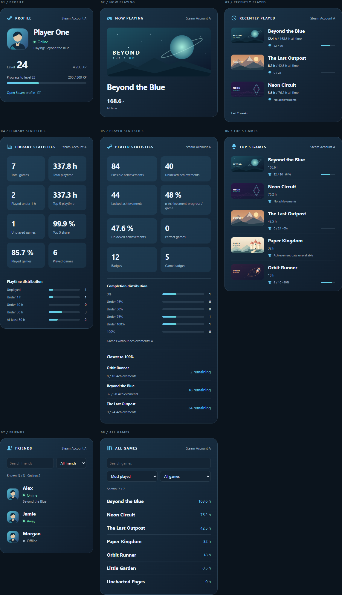

# Steam Tracker Card visual guide

Steam Tracker Card **1.0.0**, with fictional account data and local game artwork.
The gallery contains **96 cards**: eight views in three layouts, two languages,
and two appearances.

## Choose an appearance and language

| Appearance | English | German |
| --- | --- | --- |
| Steam blue | [English gallery](visual-guide/steam-en.md) | [German gallery](visual-guide/steam-de.md) |
| Home Assistant theme | [English gallery](visual-guide/theme-en.md) | [German gallery](visual-guide/theme-de.md) |

Each gallery compares Detailed, Compact, and Single line side by side. Click an
image to open the full-resolution PNG. The theme examples use a light reference
theme; your Home Assistant theme determines the colors on your dashboard.

## Find a view

| View | Steam / English | Theme / English | Steam / German | Theme / German |
| --- | --- | --- | --- | --- |
| Profile | [View](visual-guide/steam-en.md#profile) | [View](visual-guide/theme-en.md#profile) | [View](visual-guide/steam-de.md#profile) | [View](visual-guide/theme-de.md#profile) |
| Current game | [View](visual-guide/steam-en.md#current-game) | [View](visual-guide/theme-en.md#current-game) | [View](visual-guide/steam-de.md#current-game) | [View](visual-guide/theme-de.md#current-game) |
| Recently played | [View](visual-guide/steam-en.md#recently-played) | [View](visual-guide/theme-en.md#recently-played) | [View](visual-guide/steam-de.md#recently-played) | [View](visual-guide/theme-de.md#recently-played) |
| Library statistics | [View](visual-guide/steam-en.md#library-statistics) | [View](visual-guide/theme-en.md#library-statistics) | [View](visual-guide/steam-de.md#library-statistics) | [View](visual-guide/theme-de.md#library-statistics) |
| Player statistics | [View](visual-guide/steam-en.md#player-statistics) | [View](visual-guide/theme-en.md#player-statistics) | [View](visual-guide/steam-de.md#player-statistics) | [View](visual-guide/theme-de.md#player-statistics) |
| Top 5 games | [View](visual-guide/steam-en.md#top-5-games) | [View](visual-guide/theme-en.md#top-5-games) | [View](visual-guide/steam-de.md#top-5-games) | [View](visual-guide/theme-de.md#top-5-games) |
| Friends | [View](visual-guide/steam-en.md#friends) | [View](visual-guide/theme-en.md#friends) | [View](visual-guide/steam-de.md#friends) | [View](visual-guide/theme-de.md#friends) |
| All games | [View](visual-guide/steam-en.md#all-games) | [View](visual-guide/theme-en.md#all-games) | [View](visual-guide/steam-de.md#all-games) | [View](visual-guide/theme-de.md#all-games) |

## Reading the images

- Layouts correspond to `detailed`, `compact`, and `single_line` in card YAML.
- Individual cards are 420 CSS pixels wide, captured at a 2x pixel ratio.
- Single-line layouts hide the heading and show one row per list item or summary.
- The examples use one account, the default name action (`none`), and data
  freshness disabled. The main guide shows the optional freshness footer.
- All five fictional games have their own illustration. The planet in Beyond the
  Blue covers the rear half of its ring.
- Images come from the local preview. Rendering them makes no Steam requests.
