# Steam blue cards in English

[All appearances and languages](../visual-guide.md)

Screenshots of Steam Tracker Card 1.0.0 with fictional accounts and games.
Click an image to open it at full resolution. Each column names the matching YAML layout.

Steam blue uses the card's built-in gradient on a dark dashboard background.

## Configuration

Choose the view below and set its appearance and language:

```yaml
type: custom:steam-tracker-card
appearance: steam
language: en
view: profile
layout: detailed
```

YAML layouts: `detailed`, `compact`, and `single_line`.
Single-line layouts hide the heading and detailed profile/achievement information.
List views still show one row per entry, with search controls for friends and all games.

## Profile

`view: profile`

| Detailed (`detailed`) | Compact (`compact`) | Single line (`single_line`) |
| --- | --- | --- |
| <a href="../images/cards/en/steam/profile-detailed.png">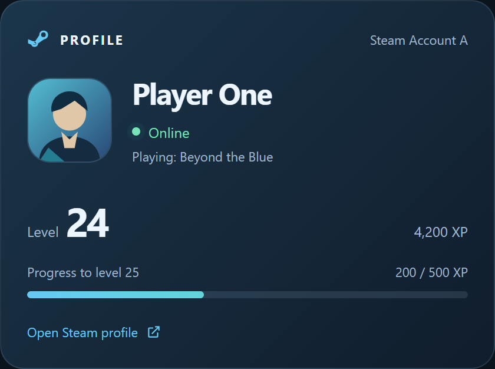</a> | <a href="../images/cards/en/steam/profile-compact.png">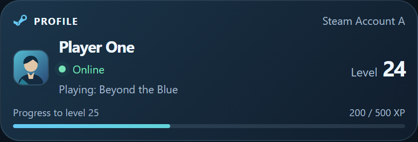</a> | <a href="../images/cards/en/steam/profile-single_line.png"></a> |

## Current game

`view: current_game`

| Detailed (`detailed`) | Compact (`compact`) | Single line (`single_line`) |
| --- | --- | --- |
| <a href="../images/cards/en/steam/current_game-detailed.png">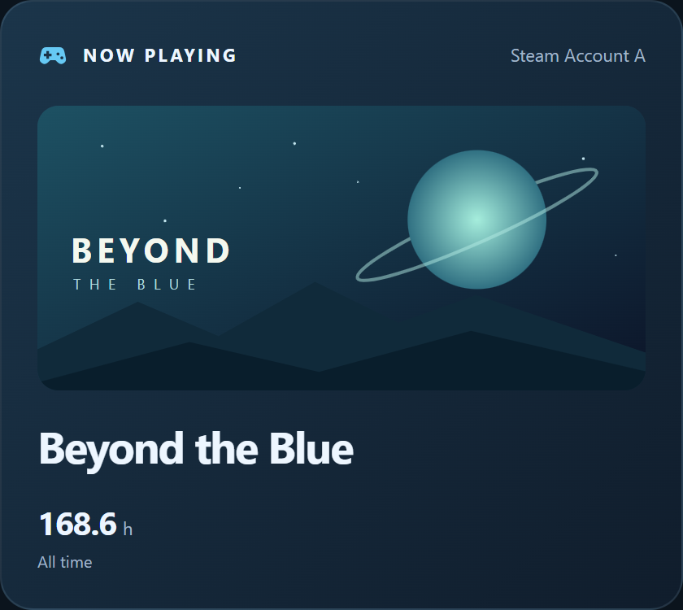</a> | <a href="../images/cards/en/steam/current_game-compact.png">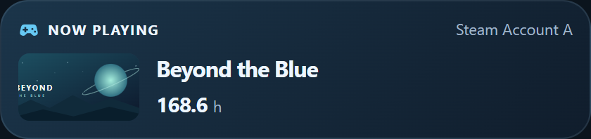</a> | <a href="../images/cards/en/steam/current_game-single_line.png">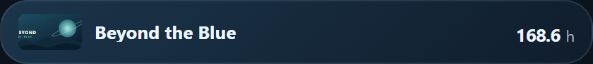</a> |

## Recently played

`view: recent_games`

| Detailed (`detailed`) | Compact (`compact`) | Single line (`single_line`) |
| --- | --- | --- |
| <a href="../images/cards/en/steam/recent_games-detailed.png">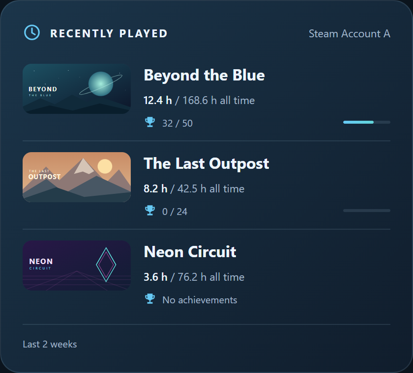</a> | <a href="../images/cards/en/steam/recent_games-compact.png">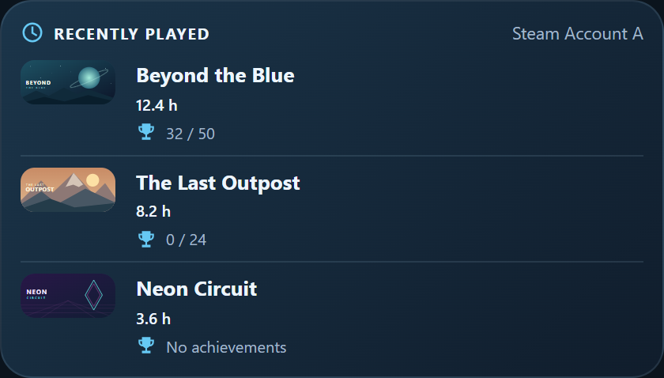</a> | <a href="../images/cards/en/steam/recent_games-single_line.png">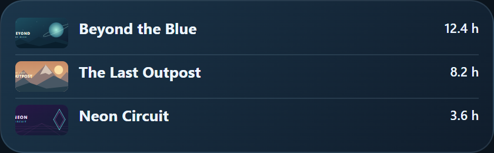</a> |

## Library statistics

`view: library_stats`

| Detailed (`detailed`) | Compact (`compact`) | Single line (`single_line`) |
| --- | --- | --- |
| <a href="../images/cards/en/steam/library_stats-detailed.png">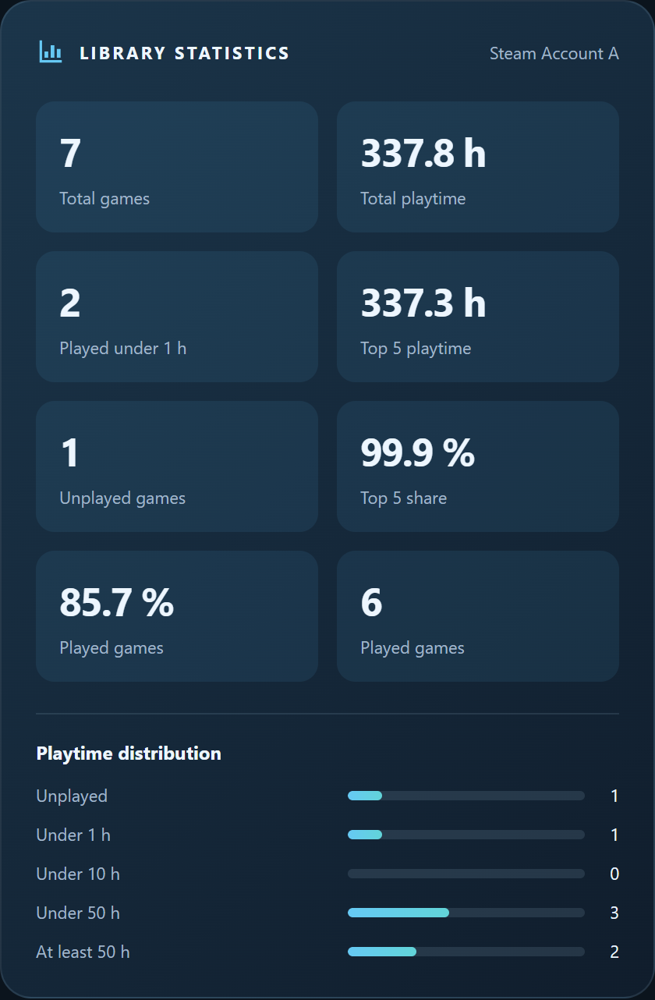</a> | <a href="../images/cards/en/steam/library_stats-compact.png">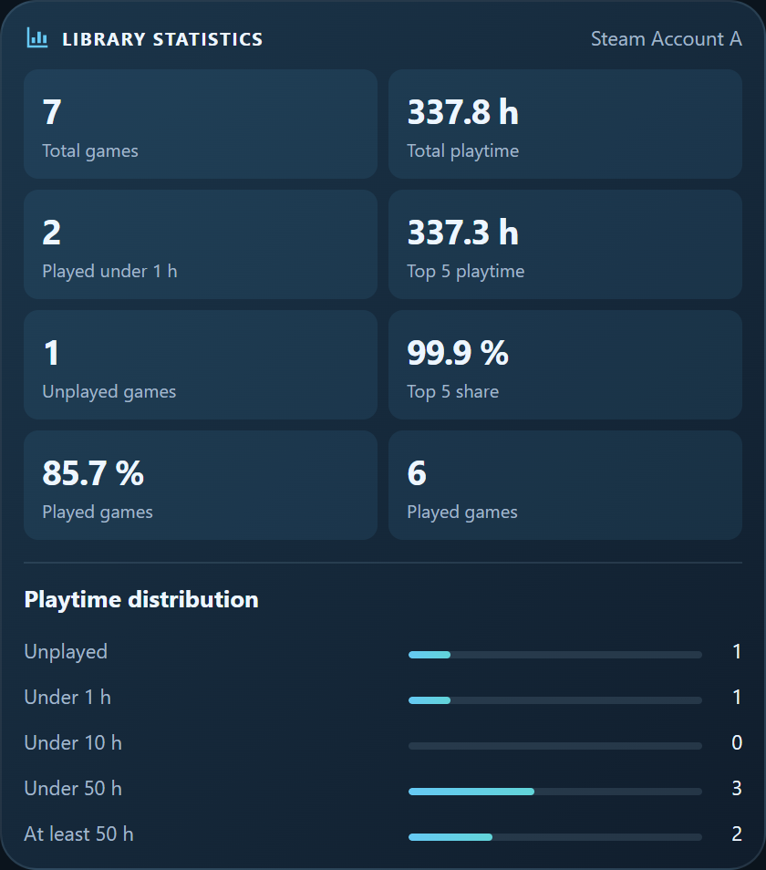</a> | <a href="../images/cards/en/steam/library_stats-single_line.png">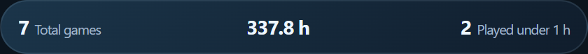</a> |

## Player statistics

`view: player_stats`

| Detailed (`detailed`) | Compact (`compact`) | Single line (`single_line`) |
| --- | --- | --- |
| <a href="../images/cards/en/steam/player_stats-detailed.png">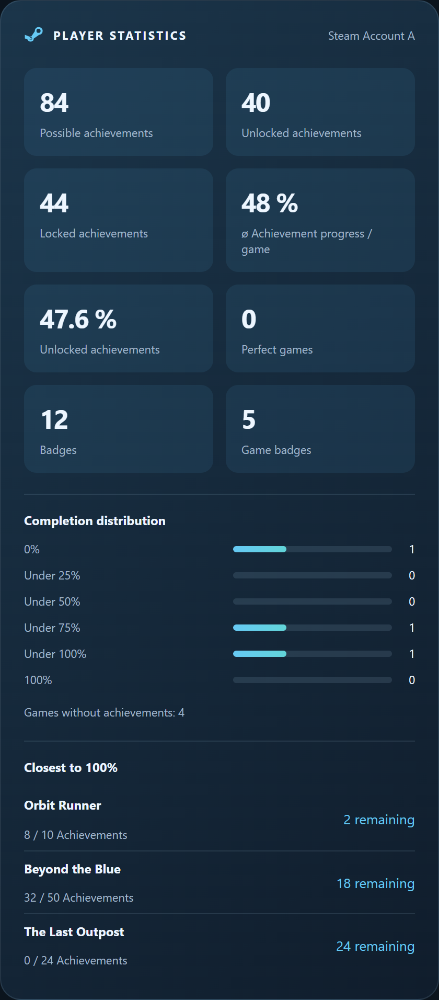</a> | <a href="../images/cards/en/steam/player_stats-compact.png">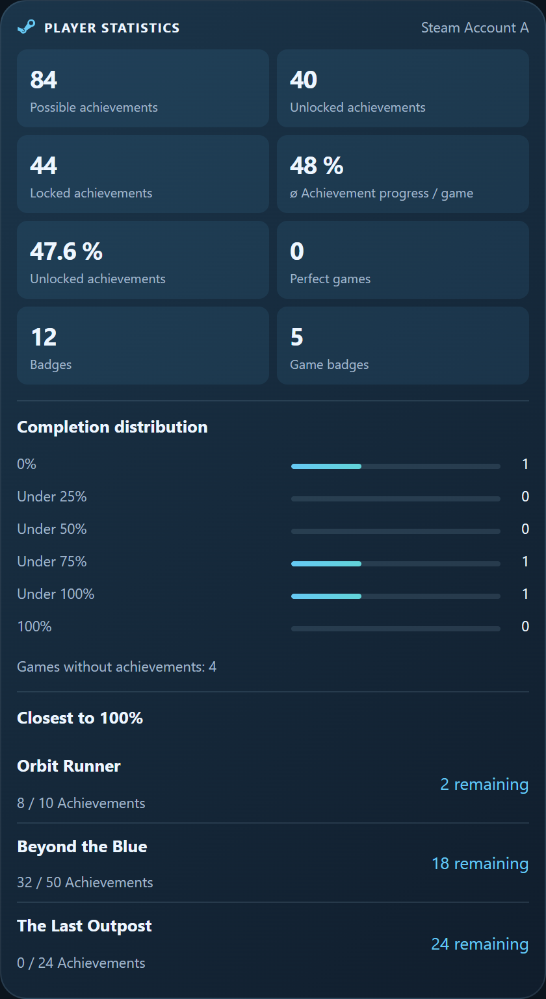</a> | <a href="../images/cards/en/steam/player_stats-single_line.png">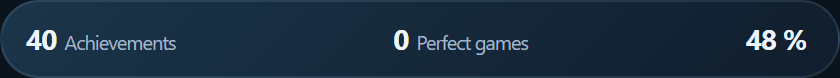</a> |

## Top 5 games

`view: top_games`

| Detailed (`detailed`) | Compact (`compact`) | Single line (`single_line`) |
| --- | --- | --- |
| <a href="../images/cards/en/steam/top_games-detailed.png">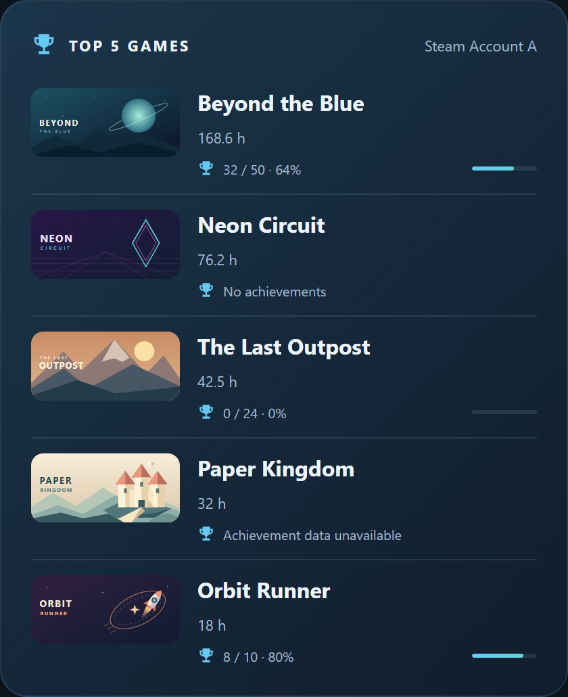</a> | <a href="../images/cards/en/steam/top_games-compact.png">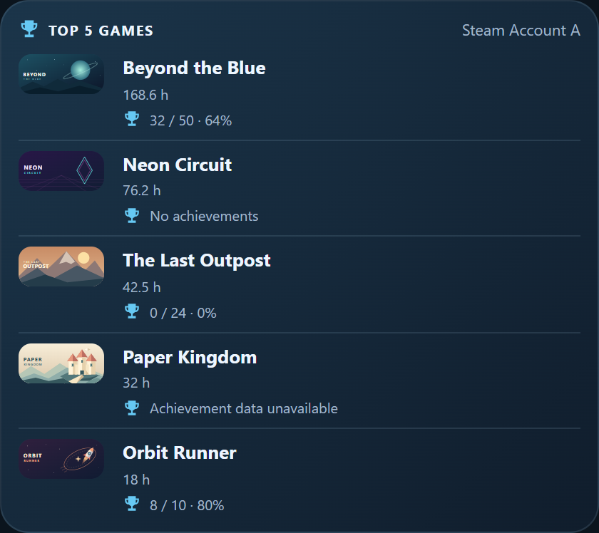</a> | <a href="../images/cards/en/steam/top_games-single_line.png">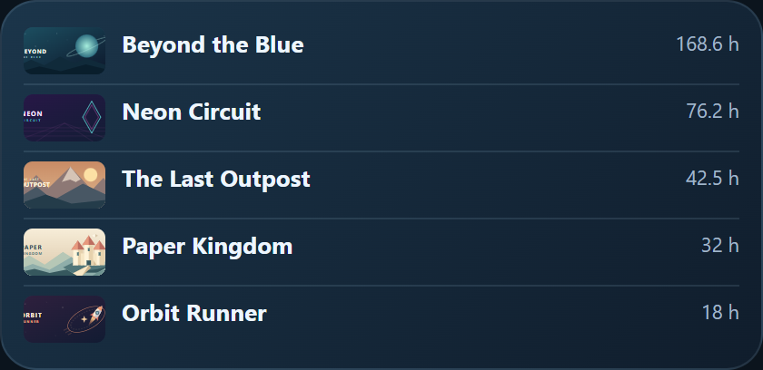</a> |

## Friends

`view: friends`

| Detailed (`detailed`) | Compact (`compact`) | Single line (`single_line`) |
| --- | --- | --- |
| <a href="../images/cards/en/steam/friends-detailed.png">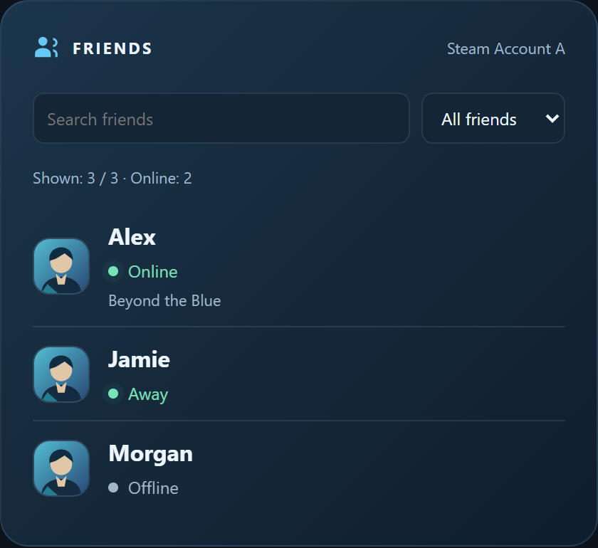</a> | <a href="../images/cards/en/steam/friends-compact.png">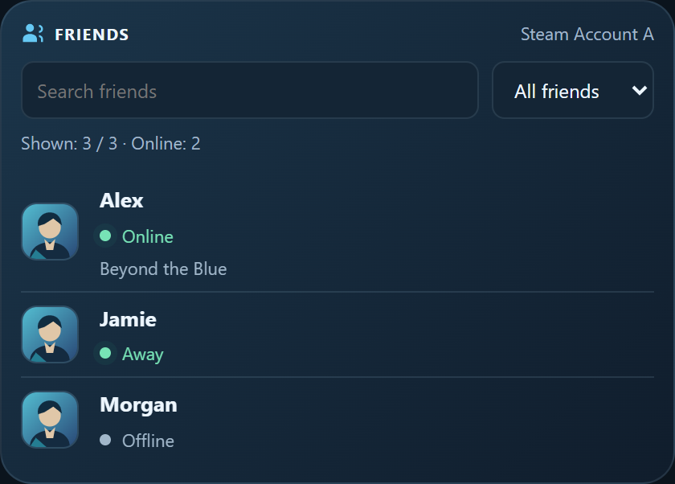</a> | <a href="../images/cards/en/steam/friends-single_line.png">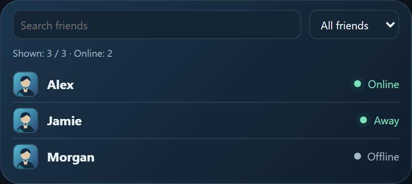</a> |

## All games

`view: games`

| Detailed (`detailed`) | Compact (`compact`) | Single line (`single_line`) |
| --- | --- | --- |
| <a href="../images/cards/en/steam/games-detailed.png">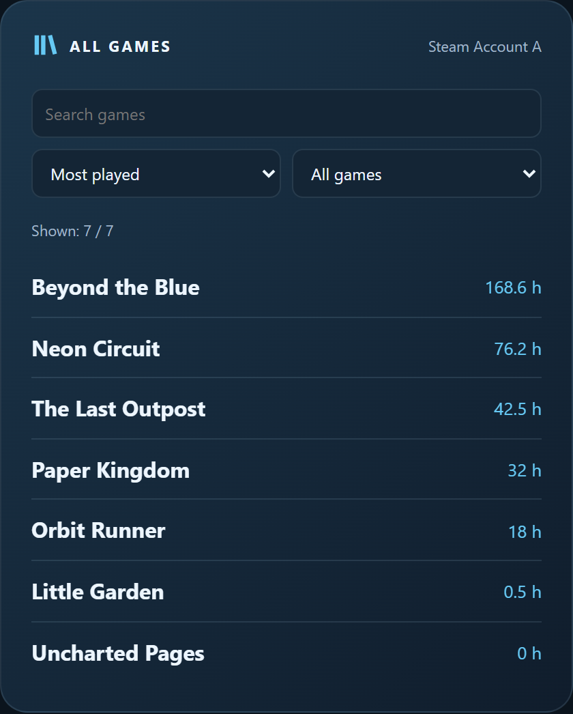</a> | <a href="../images/cards/en/steam/games-compact.png">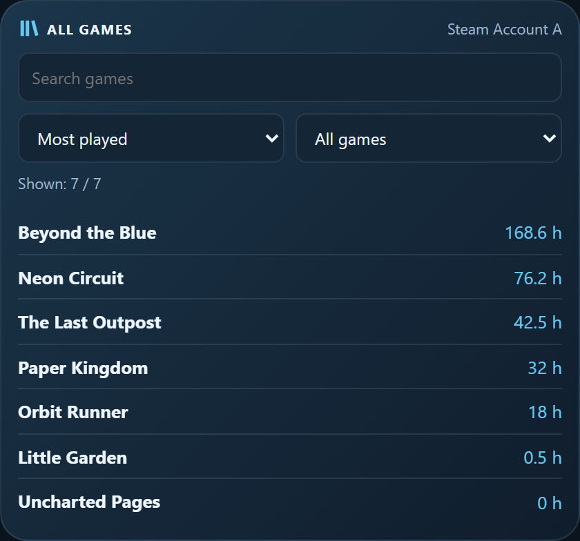</a> | <a href="../images/cards/en/steam/games-single_line.png">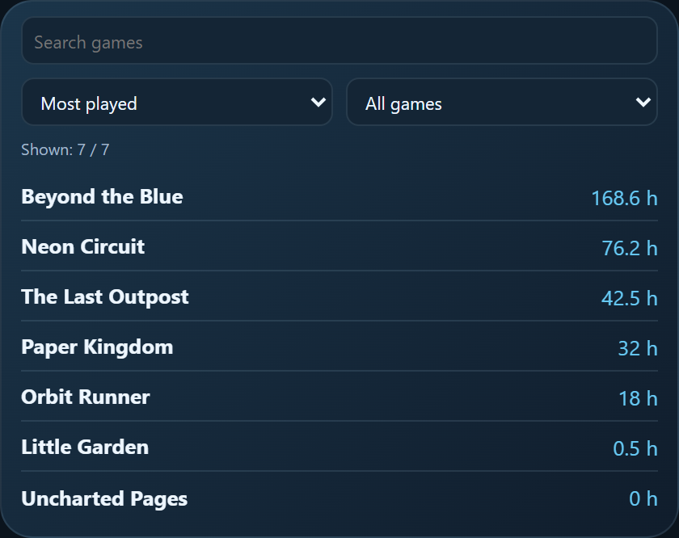</a> |
